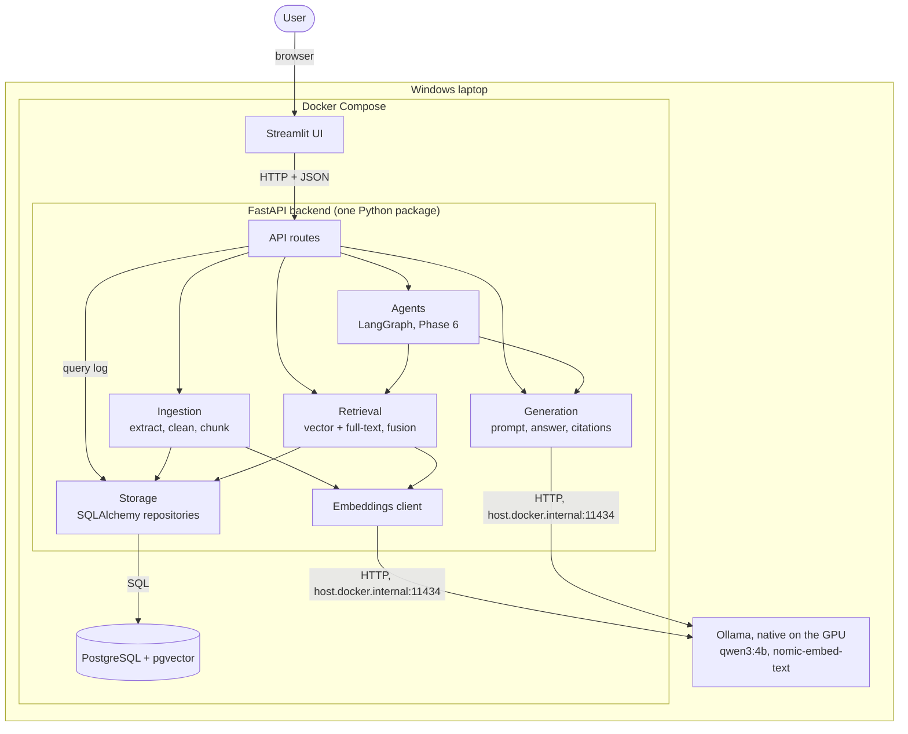

# Architecture

Last updated: 2026-11-13. This describes the target design. Parts marked with a phase are not built yet.
Requirements referenced below (FR-, NFR-, UC-) are defined in [requirements.md](requirements.md).

## 1. Overview

The system is a modular monolith that runs entirely on one Windows laptop. A single Python package serves a FastAPI backend whose internal modules ingest PDFs, store chunks and vectors in PostgreSQL with pgvector, retrieve relevant passages, and generate cited answers with a local language model served by Ollama on the laptop's GPU. No paid services are used, and no document or query text leaves the machine (NFR-01, NFR-02).

## 2. Components

| Component | Responsibility | Technology | Runs in | Requirements |
| --- | --- | --- | --- | --- |
| Streamlit UI | Upload documents, ask questions, show answers with citations and query details | Streamlit | Its own process | FR-01, FR-08, UC-06 |
| API routes | HTTP endpoints, input validation, clear error responses, query logging | FastAPI, Pydantic | API process | FR-01, FR-06, FR-10, FR-11 |
| Ingestion | Extract text page by page, clean it, split it into chunks with metadata; reject unusable PDFs with a recorded error | PyMuPDF | API process | FR-02, FR-03, NFR-09 |
| Embeddings client | Turn chunks and questions into vectors, in batches, with the model's required prefixes | Ollama HTTP API | API process | FR-04 |
| Storage | Read and write documents, chunks, vectors and query logs; delete a document and everything derived from it in one transaction | SQLAlchemy, Alembic | API process | FR-04, FR-10, FR-11 |
| Retrieval | Combine vector similarity and full-text search into one ranked list of chunks | pgvector, PostgreSQL full-text search | API process | FR-05 |
| Generation | Build the grounded prompt, call the local language model, verify citations, refuse when evidence is missing | Ollama HTTP API | API process | FR-07, FR-08, FR-09 |
| Agents (Phase 6) | Multi-step workflows over approved tools, with memory and a human approval step | LangGraph | API process | FR-12, FR-13, FR-14 |
| Evaluation (Phase 7) | Offline harness that runs question sets, computes metrics and stores results | pytest, pandas | Host, through uv | FR-15, NFR-05, NFR-06 |
| PostgreSQL + pgvector | Persistent storage for documents, chunks, vectors, query logs and agent checkpoints | PostgreSQL 17, pgvector | Docker | FR-04, FR-10 |
| Ollama | Serves the embedding model and the answer model on the GPU | Ollama | Windows host | FR-07, NFR-02 |

## 3. Main flows

### Ingestion

1. The user uploads a PDF through the UI or `POST /documents` (FR-01).
2. The API checks the file type and size and rejects anything else with a clear error.
3. Ingestion extracts text page by page and records the title and each page's extraction status (FR-02). Corrupt, empty or image-only files stop here with a recorded error and do not affect other documents (NFR-09).
4. Ingestion cleans the text and splits it into chunks that keep document, title, page and section-heading metadata (FR-03).
5. The embeddings client sends the chunks to Ollama in batches, each prefixed with `search_document:`.
6. Storage writes the document, its chunks and their vectors in one transaction (FR-04). Uploading the same file again replaces its chunks instead of duplicating them.
7. The API returns the document's status, and the UI shows it as ready for questions (UC-02).

### Question answering

1. The user asks a question in natural language (FR-06).
2. The embeddings client embeds the question with the `search_query:` prefix.
3. Retrieval runs vector similarity search and full-text search, fuses both result lists into one ranking, and keeps the top chunks that fit the model's 4K-token context (FR-05).
4. Generation builds the prompt (grounding rules, numbered passages, the question) and calls the language model (FR-07).
5. Generation checks that every citation points to a retrieved chunk and strips any leaked reasoning text. If the passages do not support an answer, it returns "not found in the documents" (FR-08, FR-09).
6. The API logs the question, retrieved chunk IDs, model and settings, the answer or refusal, any errors, and the latency (FR-11).
7. The UI shows the answer with its citations, and the query details on request (UC-06).

## 4. Deployment

| Component | Development (Phases 2–7) | Target (Phase 8) | Port |
| --- | --- | --- | --- |
| PostgreSQL + pgvector | Docker Compose | Docker Compose | 5432 inside Docker; published on `localhost:5433` |
| FastAPI backend | uv on Windows | Docker Compose | 8000 |
| Streamlit UI | uv on Windows | Docker Compose | 8501 |
| Ollama | Windows host | Windows host | 11434 |

Addresses differ by where the code runs. During development, the API reaches the database at `localhost:5433` and Ollama at `localhost:11434`. Inside Docker, it uses `db:5432` and `host.docker.internal:11434`. These addresses come from configuration, never from code.

## 5. Cross-cutting concerns

- **Configuration:** every setting comes from environment variables loaded with pydantic-settings and documented in `.env.example`: database URL, Ollama URL, model names, `num_gpu`, thinking mode, chunk size and the number of retrieved chunks. No secrets live in the code.
- **Model interfaces:** the embeddings client and the language model sit behind small Python interfaces. Unit tests and CI use fake implementations, so they never need Ollama (NFR-08).
- **Logging:** structured logs for every request, plus the query log table for auditing (FR-11, UC-06).
- **Errors:** domain errors map to clear API responses: 4xx for bad input, 503 when Ollama or the database is unavailable.
- **Data:** only public or synthetic documents are processed. The repository stores a manifest and a download script, never the PDFs themselves.

## 6. Decisions

- [ADR 0001: Modular monolith](adr/0001-modular-monolith.md)
- [ADR 0002: PostgreSQL with pgvector](adr/0002-postgresql-pgvector.md)
- [ADR 0003: Ollama running natively on Windows](adr/0003-native-ollama.md)
- [ADR 0004: Full GPU offload with num_gpu 99](adr/0004-full-gpu-offload.md)

The benchmark environment is documented in [environment.md](environment.md).